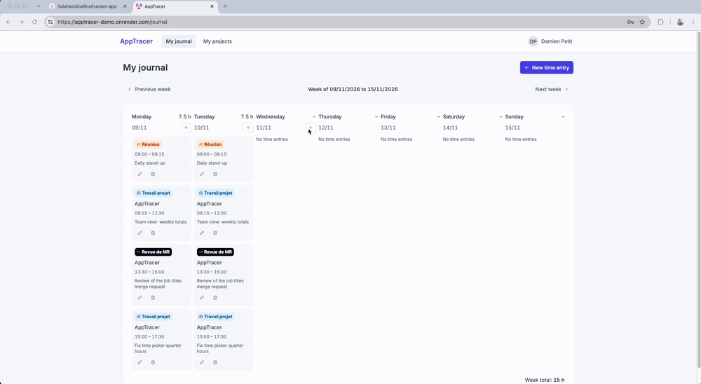
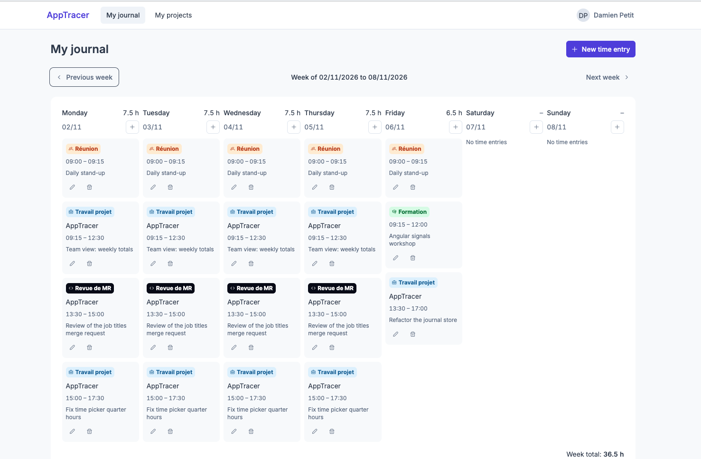
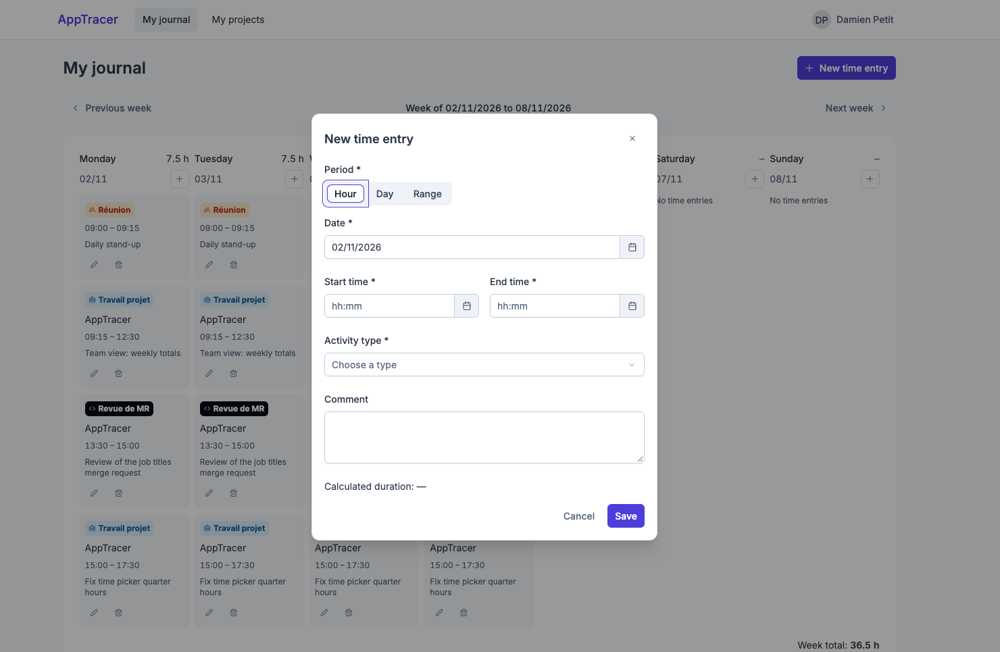
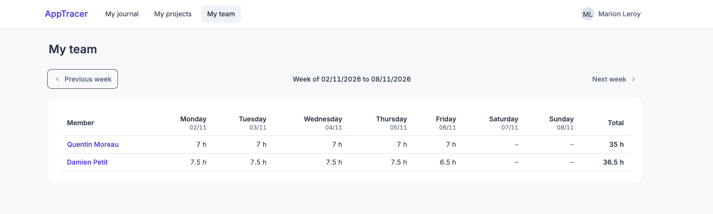
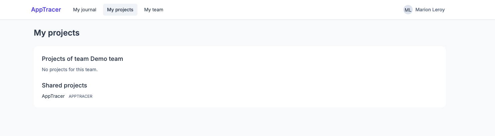
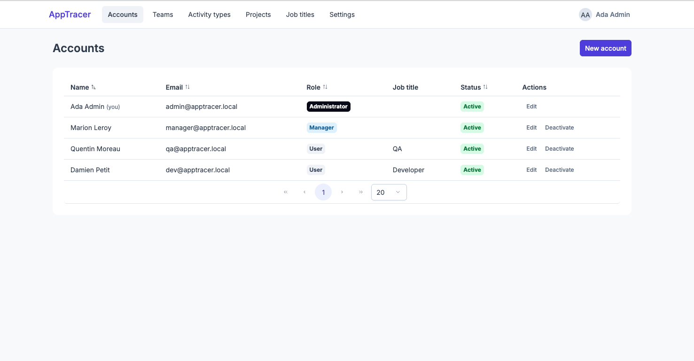
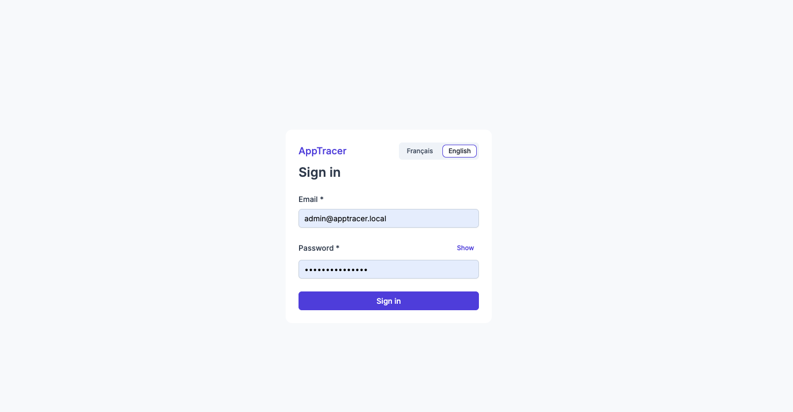
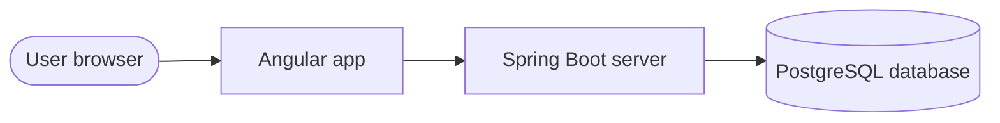

# AppTracer — Activity log

**Employees log what they worked on — by the hour, the day or a range of days — and managers see their team's week
at a glance.**

[](https://github.com/SalaheddineBns/apptracer/actions/workflows/ci.yml)
[](LICENSE)
 
 



## Live demo

**[apptracer-demo.onrender.com](https://apptracer-demo.onrender.com)**

| Account | E-mail | Password | What to try |
|---|---|---|---|
| Manager | `manager@apptracer.local` | `Salaheddine@@12` | **My team**: the week of the developer and the QA, then a member's journal (read-only) |
| Developer | `dev@apptracer.local` | `Salaheddine@@12` | **My journal**: the last two weeks are filled in; add, edit or delete an entry |
| QA | `qa@apptracer.local` | `Salaheddine@@12` | **My journal** with another job title (QA) in the same team |

- The demo runs on a free server that sleeps when idle: the **first visit can take up to a minute**.
- All data is **reset every night** (03:00 UTC): feel free to change anything.
- The administrator account is not shared publicly; its screens are described in [Roles](#roles-and-permissions).

## Features

- **Weekly journal**: one week per page, entries as coloured cards, the total of each day next to its name and the
  week total at the bottom; a **+** on each day adds an entry for that date.
- **Three granularities**: an hour slot (15-minute steps), a full day, or a range of up to 31 days; the duration is
  computed live before saving.
- **Reliable data**: no overlapping entries, no future start, durations frozen when saved, every change traced.
- **Team view for managers**: one row per member, one column per day, read-only access to each member's journal.
- **Administration**: accounts and roles, teams, job titles (Developer, QA, Tech Lead…), activity types, projects and
  the length of the standard day.
- **English and French**, switched from the interface.

## Screenshots

| My journal | New time entry |
|---|---|
|  |  |
| **My team (manager)** | **My projects** |
|  |  |
| **Accounts (admin)** | **Sign in** |
|  |  |

## Architecture



The browser loads the Angular app and then calls the API on the same address. The API is the only part that talks
to the database. Its OpenAPI contract is exported to [`docs/api/openapi.json`](docs/api/openapi.json), and the
Angular TypeScript client is generated from it.

| Layer | Technology |
|---|---|
| Frontend | Angular 22 (standalone components, signals), PrimeNG, Tailwind CSS (`tailwindcss-primeui`) |
| Backend | Java 21, Spring Boot 3 (Web, Data JPA, Security, Validation), Maven |
| Database | PostgreSQL 16, schema migrations with Flyway |
| API contract | OpenAPI (springdoc); the Angular TypeScript client is generated from it, never written by hand |
| Security | Spring Security + JWT: short-lived access token, single-use refresh token stored server-side |
| Tests | JUnit 5, Mockito, Testcontainers (back), Vitest (front), Cypress (end-to-end) |

## Getting started

Prerequisites: Docker, Java 21, Node.js 22.22+ or 24.15+ (required by the Angular CLI), and a `.env` file at the
root with the variables below.

```bash
docker compose up -d db                   # PostgreSQL on port 5432
cd backend && ./mvnw spring-boot:run      # API on http://localhost:8080
cd frontend && npm install && npm start   # app on http://localhost:4200
```

<details>
<summary>All commands (tests, lint, end-to-end, API client)</summary>

| Action | Command |
|---|---|
| Backend tests | `cd backend && ./mvnw test` |
| Format backend code | `cd backend && ./mvnw spotless:apply` |
| Frontend tests | `cd frontend && npx ng test --watch=false` |
| Frontend lint | `cd frontend && npx ng lint` |
| End-to-end tests on an isolated, disposable stack | `cd frontend && npm run e2e:stack` |
| Same stack left running for a manual demo | `cd frontend && npm run demo:stack` |
| Export the OpenAPI contract | `cd backend && ./mvnw test -Dtest=OpenApiExportTest` |
| Regenerate the API client | `cd frontend && npm run api:generate` |

</details>

<details>
<summary>Configuration (environment variables)</summary>

- `POSTGRES_DB`, `POSTGRES_USER`, `POSTGRES_PASSWORD`, `DB_HOST`, `DB_PORT`, `DB_SSLMODE` for the database;
- `JWT_SECRET` (mandatory, 32 bytes or more), plus `JWT_ACCESS_TTL` and `JWT_REFRESH_TTL` for the tokens;
- `ADMIN_EMAIL`, `ADMIN_PASSWORD`, `ADMIN_FIRST_NAME`, `ADMIN_LAST_NAME` for the **initial ADMIN account**, created
  at first start-up if no ADMIN exists. Use this account to create the other users;
- `DEMO_PASSWORD` (optional, never in production) to also create, at start-up, the three demo accounts above, their
  team **Demo team**, the project **AppTracer** and the ten previous working days of entries for the developer and
  the QA. Existing accounts are left untouched and nothing is created twice;
- `PORT` for the HTTP port (8080 by default).

The full list, with defaults, is in
[`backend/src/main/resources/application.yml`](backend/src/main/resources/application.yml).

</details>

Want to contribute? Read [`CONTRIBUTING.md`](CONTRIBUTING.md) for the workflow, conventions and checks.

## Roles and permissions

Every account has exactly one role. **MANAGER includes all USER rights.** An ADMIN manages the application and has
no journal.

| Action | USER | MANAGER | ADMIN |
|---|:---:|:---:|:---:|
| Sign in, change own password, switch language | ✅ | ✅ | ✅ |
| Record / edit / delete own entries (**My journal**) | ✅ | ✅ | — |
| See daily and weekly totals of own journal | ✅ | ✅ | — |
| Consult a managed team and its members' journals (read-only) | — | ✅ | — |
| Edit or delete someone else's entry | — | — | — |
| Read active activity types and projects | ✅ | ✅ | ✅ |
| Manage activity types and projects | — | — | ✅ |
| Manage accounts, roles and job titles | — | — | ✅ |
| Manage teams, managers and members | — | — | ✅ |
| Change the standard day | — | — | ✅ |

<details>
<summary>What each role can do, screen by screen</summary>

### USER — employee
- Signs in, changes their own password (the old one is required; other sessions are closed), and switches the
  interface between English and French.
- Records, edits and deletes **their own** time entries in **My journal** (`/journal`), and sees their daily and
  weekly totals.
- Sees only their own entries: never anyone else's.

### MANAGER — team manager
- Everything a USER can do, with their own journal.
- Opens **My team** (`/team`) to consult, **read-only**, the teams they manage:
  - a table with one row per member, one column per day (hours) and the week total;
  - a team selector when they manage several teams (the first in alphabetical order is shown by default);
  - a click on a member opens **that member's journal** for the week (`/team/members/:userId`), with comments,
    and no create, edit or delete button.
- Sees only the **current members** of the teams they manage, including the members' older entries. A member who
  leaves the team is no longer visible. The manager's own entries do not appear in their team's view.

### ADMIN — administrator
- Has no journal: after signing in, lands on **Accounts**.
- **Accounts** (`/admin/accounts`): creates accounts (e-mail, name, role, optional job title, initial password),
  edits name, role and job title, deactivates and reactivates them. An ADMIN cannot deactivate their own account or
  remove their own ADMIN role. A deactivated account can no longer sign in, and its sessions are revoked.
- **Teams** (`/admin/teams`): creates, edits and deletes teams, chooses their manager (an active MANAGER) and their
  members (USER or MANAGER accounts). A manager of a team cannot be deactivated or lose the MANAGER role until the
  team gets another manager or is deleted.
- **Activity types** (`/admin/activity-types`) and **projects** (`/admin/projects`): creates, edits, deactivates and
  reactivates them. They are never deleted. An inactive type or project is no longer offered for new entries, but
  existing entries keep displaying it. Once a type is used by an entry, its "project required" flag is frozen.
- **Job titles** (`/admin/job-titles`): Developer, Tech Lead, QA, Scrum Master, Product Owner, Data Analyst at
  installation; creates, renames, deactivates and reactivates them. A job title describes what a USER or MANAGER
  does and never grants rights; an ADMIN has none.
- **Settings** (`/admin/settings`): sets the **standard day** (between 1 h and 24 h, by 15-minute steps). The screen
  shows who changed it last and when. The change applies only to entries created or edited afterwards.

</details>

## How time entries work

| Concept | Meaning |
|---|---|
| **Time entry** | One declared activity over a period, with an activity type, an optional project and an optional comment (500 characters max). |
| **Granularity** | **Hour**: a time slot within one day, by 15-minute steps. **Day**: a full day. **Range**: several consecutive days, 31 at most. |
| **Activity type** | The nature of the work. Initial types (stored in French, shown as is): *Travail projet* (project work), *Réunion* (meeting), *Lecture de SFD* (spec reading), *Revue de MR* (merge request review), *Formation* (training), *Autre* (other). Each type has a colour and says whether a project is required. |
| **Project** | What the work is about. Required for some types (e.g. *Travail projet*, *Revue de MR*), forbidden for the others. |
| **Standard day** | The length of a working day: **8 h (480 min)** at installation, adjustable by an ADMIN. It is used to compute the duration of a Day or a Range. |
| **Team** | A named group with exactly one manager and any number of members. A person belongs to at most one team. |

<details>
<summary>Rules applied to every entry</summary>

- **No overlap**: two entries of the same person cannot cover the same time. An Hour slot excludes its end time
  (09:00–10:00 and 10:00–11:00 are fine); a Day or a Range occupies every day it covers, weekends included.
- **No future start**: the start date cannot be after today (Europe/Paris time). A Range may end in the future.
- **Durations**:
  - Hour = the exact gap, by 15-minute steps (latest end time 23:45);
  - Day = one standard day, even on a Saturday or Sunday;
  - Range = number of working days (Monday–Friday) × standard day; public holidays count as working days.
- **Frozen durations**: a duration is computed and stored when the entry is saved. Changing the standard day later
  never recalculates existing entries.
- **Weekly totals**: a Range spanning several weeks only counts, in each week, its working days within that week.
- **Traceability**: every creation, modification and deletion records who did it and when. Deletion is logical: a
  deleted entry disappears from the journal and from the totals.

</details>

## Deployment

The public demo runs as **one free container**: the [`Dockerfile`](Dockerfile) builds the Angular app and serves it
from the Spring Boot API. It is described for Render in [`render.yaml`](render.yaml), with a free PostgreSQL database
on Neon.

<details>
<summary>Set up your own demo (about 20 minutes)</summary>

1. **Database**: create a free project on [Neon](https://neon.tech) (region Frankfurt) and note its host, database,
   user and password.
2. **App**: on [Render](https://render.com), choose *New > Blueprint*, select this repository, then fill in the values
   it asks for: the Neon connection, `ADMIN_PASSWORD` (kept private), `DEMO_PASSWORD` (published with the demo
   accounts) and `PRIMEUI_LICENSE`. Render builds the image and deploys it on every push to `main`.
3. **Nightly reset**: in Render, copy the service's *Deploy Hook* URL. In GitHub, add two repository secrets:
   `RENDER_DEPLOY_HOOK_URL` and `DEMO_DATABASE_URL` (the Neon connection string). The
   [`Demo reset`](.github/workflows/demo-reset.yml) workflow then empties the database every night and redeploys;
   it can also be run by hand from the *Actions* tab.

</details>

## Project layout and references

```
backend/    Spring Boot API (/api/v1), Flyway migrations, tests
frontend/   Angular application, generated API client, Cypress e2e tests
docs/api/   OpenAPI contract (openapi.json), source of the generated client
docs/sfd/   functional specifications: business rules (RG-xx-yy) and acceptance criteria (CA-xx-yy)
```

| Reference | Content |
|---|---|
| [`docs/sfd/`](docs/sfd/00-vue-ensemble.md) | Functional specifications: start with the overview; every rule (`RG-xx-yy`) and acceptance criterion (`CA-xx-yy`) cited in the code is defined there |
| [`docs/api/openapi.json`](docs/api/openapi.json) | REST API contract (OpenAPI 3): every endpoint, request and response |
| [`backend/src/main/resources/db/migration/`](backend/src/main/resources/db/migration/) | Database schema, one Flyway migration per change |
| [`backend/src/main/resources/application.yml`](backend/src/main/resources/application.yml) | Backend configuration and the environment variables it reads |

## License

AppTracer is released under the [MIT License](LICENSE). To report a vulnerability, see [`SECURITY.md`](SECURITY.md).
The version history is in [`CHANGELOG.md`](CHANGELOG.md).
